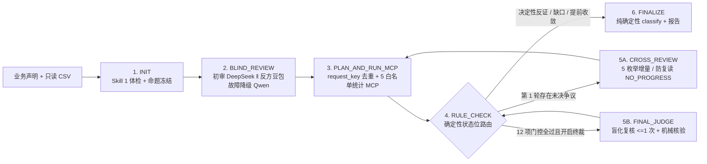

# 数证 Audit（Shuzheng Audit）

面向数字经济场景的多 Agent 数据结论审计与证据验证系统（数字经济硕士四人组课程项目）。

> **核心答辩定位**：*ThinkClaw 让多个 AI 通过辩论形成意见；数证 Audit 让多个 AI 通过辩论发现需要验证的问题，再由可追溯证据和确定性规则决定结论是否成立。*

---

## 一、系统架构图（三权分立 + 6 阶段有界状态机）



---

## 二、相比 ThinkClaw 的核心升级对比

| 维度 | 传统多 Agent 辩论（ThinkClaw 范式） | 数证 Audit（本系统） |
| :--- | :--- | :--- |
| **裁决机制** | 模型投票或由总结模型主观拍板 | **三权分立**：Agent 仅提待验证问题，最终结论由纯确定性函数 `classify(state)` 生成 |
| **取证方式** | 自由文本推理或开放代码执行 | **5 个白名单确定性统计 MCP**（严禁 `eval`/`exec`/`query`），每条证据带唯一 `evidence_id` |
| **防幻觉与止损** | 缺字段时易编造理由妥协 | 关键字段/因果缺口直接触发 `insufficient`，**0 次**昂贵终裁调用 |
| **收敛与预算** | 多轮发散复读、成本不可控 | 强制 6 条不变量：`round<=2`、`judge_calls<=1`、零重复工具、零越权覆盖、硬预算熔断 |
| **物理安全** | 易受表头 Prompt 注入与公式注入 | 列名强制映射为 `col_01..`、路径 `.resolve()` 防穿越、导出自动转义公式前缀 |

---

## 三、快速安装与 4 个独立个人 Skill 运行指令

```bash
python3.11 -m venv .venv
source .venv/bin/activate
pip install -e ".[ui]"
pytest -v
python scripts/check_secrets.py
```

### 4 位成员独立可复用 Skill（脱离主工作流均可单独运行）

1. **成员 1 — Skill 1 数据质量与语义体检（`/inspect`）**
   ```bash
   python -m skills.skill_1_data_profiler.cli inspect --data data/fixtures/case_03_promo_confounding.csv
   ```
2. **成员 2 — Skill 2 白名单受控统计 MCP（`/verify` 与 `stdio` Server）**
   ```bash
   python -m skills.skill_2_stat_mcp.cli verify \
     --data data/fixtures/case_03_promo_confounding.csv \
     --tool group_compare --target-col col_04 --group-col col_02 --stratify-col col_03
   # 启动标准 stdio MCP Server（Python 3.11+）：
   python -m skills.skill_2_stat_mcp.server
   ```
3. **成员 3 — Skill 3 命题冻结与双轮增量验证规划（`/challenge`）**
   ```bash
   python -m skills.skill_3_claim_planner.cli challenge \
     --data data/fixtures/case_03_promo_confounding.csv \
     --claim "发放消费券使商户订单增加了 48 单。"
   ```
4. **成员 4 — Skill 4 确定性规则裁决与证据链报告（`/report`）**
   ```bash
   python -m skills.skill_4_evidence_auditor.cli report --input path/to/state_bundle.json
   ```

### 端到端 `/audit` 主工作流、4 组消融评测与观测看板

```bash
# 1. 端到端审计（输出 report.md / verdict.json / trace.json 至 workspace/outputs/<run_id>/）
python -m workflows.cli audit \
  --data data/fixtures/case_03_promo_confounding.csv \
  --claim "发放消费券使商户订单增加了 48 单。" --trace --budget 1.0

# 2. 生成 20 份完整基准集并运行 R0/R1/R2/R5 四组消融评测
python data/generate_benchmark.py --scale full
python -m evals.run_ablation --scale full

# 3. 启动极简 Streamlit 过程观测台
streamlit run app/dashboard.py
```

---

## 四、《5 分钟随机抽签答辩速查提纲》

1. **开场 45 秒（痛点与定位）**：商业报告里常见三类“看起来很对的错结论”——分母口径错、大促混淆（辛普森悖论）、头部极端值拉高均值。普通多 Agent 辩论只是“嘴上达成共识”，数证 Audit 用**三权分立**把辩论变成可追溯统计取证。
2. **核心演示 90 秒（Case 03 辛普森悖论反转）**：展示 `case_03_promo_confounding.csv`——发券组均单 `154` vs 未发券组 `106`，原始差 `+48`；R2（单 Agent）容易停在表面均值差，而数证 Audit 的反方触发 `group_compare(..., stratify_col_id=col_03)` 分层复算，大促组与非大促组内差值均严格归 `0`，规则引擎直接裁决 `CONTRADICTED`。
3. **工程深度 60 秒（安全防线 + 6 条不变量）**：展示 `col_01..` 列名物理隔离（拦截 Case 06 恶意提示词表头与公式注入）、路径穿越拦截、预算熔断、`Qwen` 诚实降级标记 `model_diversity_lost=True`，以及 T01–T12 验收全绿。
4. **实验结果 60 秒（R0/R1/R2/R5 20 份消融）**：展示 `evals/run_ablation.py` 输出表——相比 R0（固定脚本）、R1（单模型裸答）与 R2（单 Agent + MCP），R5 在保持 100% 不变量合规与可控成本下，显著压低“误判 `verified` 率”并实现缺口案例 100% 主动止损。
5. **收尾 45 秒（团队分工与个人 Skill 复用）**：4 个模块各自对应 4 位成员的独立 CLI 工具（`/inspect`、`/verify`、`/challenge`、`/report`），既可独立复用评测，又通过冻结契约 `core/schema.py` 拼装为完整系统。
